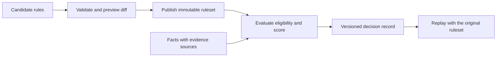

[🇬🇧 English](README.md) | [🇷🇺 Русский](README.ru.md)

# Versioned Decision Engine

Explain which evidence led to a recommendation, review a change to the rules before publishing it, and replay an earlier decision after the active rules change.

This standalone TypeScript showcase illustrates a challenge from internal decision-support tools. An operator needs to explain a recommendation using the facts and rules available at the time it was made. The example uses fictional workshops for a software operations team.

[Example decision and replay report](examples/decisions.json)

## Run the demo

Requires Node.js 22.18 or later.

```sh
npm ci
npm run check
npm test
npm run demo
```

The fictional team has a busy queue and a 45-minute recovery target. The number of on-call responders is unknown. Both queue review and a recovery drill are eligible. The on-call workshop needs more evidence.

| Scenario                                     | Ruleset | Top recommendation       |
| -------------------------------------------- | ------- | ------------------------ |
| Original decision                            | 1       | Queue reliability review |
| After publishing a revised recovery score    | 2       | Recovery drill           |
| Replay using the original evidence and rules | 1       | Queue reliability review |

Inspect `out/decisions.json` for the preview diff, captured facts, evidence source for each check, awarded points and ruleset hash. The demo asserts that the historical decision is reproduced exactly and rejects an outdated publication preview.

## Engineering decisions

- **Separate eligibility from ranking.** A failed prerequisite makes a candidate ineligible. An unknown prerequisite leaves it pending evidence. Only eligible candidates are ranked by points with a stable tie-break.
- **Explain each decision.** The evaluation records the condition, the fact and its source, and whether the condition was met, failed, or missing. Scores can be traced back to individual signals.
- **Review and publish snapshots.** A preview compares the whole candidate ruleset with the active version and shows added, changed, and removed rules. Publication requires a preview based on the version still active.
- **Keep historical results replayable.** Each result captures its evidence and identifies the immutable ruleset by version and SHA-256 digest. A prior ruleset can be reviewed and republished as a new version.



The public implementation uses generated data and in-memory version history. Publication is guarded within a single process. The package has no runtime dependencies.

[Rules and evaluator](src/engine.ts) · [Fictional scenario](src/demo.ts) · [Tests](tests/engine.test.ts)
