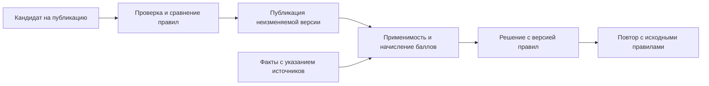

[🇬🇧 English](README.md) | [🇷🇺 Русский](README.ru.md)

# Движок рекомендаций с версионированием правил

Объясните, на каких фактах основана рекомендация, проверьте изменения правил до публикации и воспроизведите прежнее решение после смены активной версии.

Этот самостоятельный пример на TypeScript показывает задачу из внутренних систем поддержки решений. Оператору нужно объяснить рекомендацию по фактам и правилам, действовавшим в момент её формирования. В демо используются вымышленные технические консультации для команды эксплуатации ПО.

[Пример отчёта с решением и повторным расчётом](examples/decisions.json)

## Запуск

Требуется Node.js 22.18 или новее.

```sh
npm ci
npm run check
npm test
npm run demo
```

У вымышленной команды высокая нагрузка на очередь и целевое время восстановления 45 минут. Число дежурных инженеров неизвестно. Подходят разбор надёжности очереди и учения по восстановлению. Для консультации по дежурствам нужны дополнительные сведения.

| Сценарий                                        | Версия правил | Первая рекомендация       |
| ----------------------------------------------- | ------------- | ------------------------- |
| Исходное решение                                | 1             | Разбор надёжности очереди |
| После публикации нового веса для восстановления | 2             | Учения по восстановлению  |
| Повторный расчёт по исходным фактам и правилам  | 1             | Разбор надёжности очереди |

В `out/decisions.json` доступны сравнение правил перед публикацией, снимок фактов, источник для каждой проверки, начисленные баллы и хеш правил. Демо проверяет точное воспроизведение прежнего решения и отклоняет публикацию на основе устаревшего предварительного просмотра.

## Инженерные решения

- **Отдельные проверки применимости и ранжирование.** Если обязательное условие не выполняется, вариант неприменим. Если данных не хватает, вариант ожидает подтверждения. Только применимые варианты сортируются по баллам со стабильным порядком при равенстве.
- **Объяснение каждого решения.** Результат содержит условия, факты, их источники и исходы проверок. Итоговый балл можно проследить до отдельных факторов.
- **Проверка перед публикацией.** Предварительный просмотр сравнивает весь новый набор с активной версией и показывает добавленные, изменённые и удалённые правила. Публикация возможна, пока версия, использованная для сравнения, остаётся активной.
- **Воспроизводимая история.** Результат сохраняет снимок фактов, номер версии и SHA-256 неизменяемого набора правил. Старый набор можно снова проверить и опубликовать в новой версии.



В публичной реализации используются синтетические данные и история версий в памяти. Проверка публикации действует внутри одного процесса. У пакета нет зависимостей времени выполнения.

[Правила и расчёт](src/engine.ts) · [Вымышленный сценарий](src/demo.ts) · [Тесты](tests/engine.test.ts)
